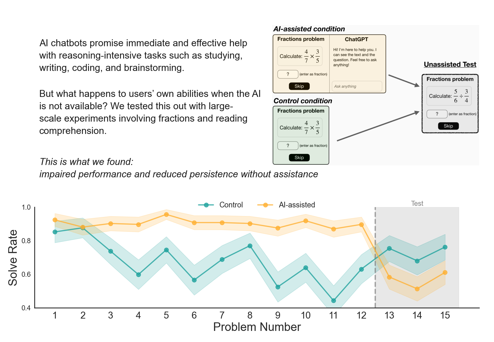

A recent preprint by [Grace Liu, Brian Christian and colleagues (2026)](https://arxiv.org/abs/2604.04721) tested this in three randomized experiments with about 1,200 people on Prolific. Participants solved fraction problems (in the third study, SAT-style reading questions), one group with GPT-5 in a sidebar, the other without AI. After roughly 10 minutes, the AI was removed and everyone solved the last three problems alone. Skipping was always possible, so giving up could be measured.

What they found:

* The AI group solved more problems while they had the AI, and fewer once it was gone. In the first study (the chart): 57% vs. 74% of test problems solved, and almost twice as many skipped (20% vs. 11%).
* Reading comprehension showed the same pattern: 76% vs. 89% solved, 8% vs. 1% skipped.
* In the second study, the drop was concentrated among the 61% who used AI for direct answers. Those using it for hints or clarification did about as well as the control group.

The design is randomized, and the drop in problem-solving performance was replicated across two different tasks, so IMO we should take that part seriously. That said, the evidence for persistence (the paper’s headline finding) seems somewhat thinner.

⚠️ A few wrinkles, though:

* The first study probably overstates the gap. It excluded people who solved fewer than 3 of 12 practice problems, a bar the AI group could clear with the AI's answers. So weaker people were likely dropped mainly from the control group. With a pretest-based rule in the larger replication, the effect on solving halved (*d* ≈ -0.2 vs. -0.4) and the skipping difference was no longer significant.
* The control group spent those minutes practising with feedback, while many AI users let the AI do the work, so some of the gap is probably missed practice (though direct-answer users also fell below their own pretest scores, which that alone doesn't explain).
* The test came right after the AI was removed, in a low-stakes setting (no pay for correct answers, skipping cost nothing). Whether the effect lasts or accumulates is unknown, as the authors note.
* The answers-vs-hints split is self-selected. The 12% who ignored the AI scored highest of all (89%), a hint that the split partly sorts people by motivation, which would exaggerate the gap.
* Nothing here separates AI from other sources of instant answers, e.g. an answer key.

For AI adoption, I see two implications. How people use AI may matter, which makes a case for testing hint-based modes in onboarding and learning ("AI as/with friction", as I called it in one of my [previous blog posts](https://blog-about-people-analytics.netlify.app/posts/2026-03-10-ai-as-friction/)). And judging AI rollouts only by what people produce with AI misses what they can still do without it, which is what we rely on when the tool is down or wrong.

Curious whether anyone has used AI outages as a natural experiment to test this in their own company… 🧐

P.S. Link to the [paper](https://arxiv.org/abs/2604.04721) and [project site](https://ai-project-website.github.io/AI-assistance-reduces-persistence/)

<!-- RELATED:BEGIN -->
## Related notes
- [[change-org-ai-outputs-vs-outcomes|Change.org: AI outputs vs outcomes]]
- [[manager-effect-lab|Good manager or lucky team?]]
- [[ai-and-bullshit-asymmetry|Can AI help us fight the bullshit asymmetry?]]
- [[ai-powered-data-exploration-assistant|Testing my GenAI skepticism]]
- [[causal-inference-in-people-analytics|Beyond prediction: Exploiting organizational events for causal inference in people analytics]]
<!-- RELATED:END -->

---
> 📄 Read the [original post with full outputs](https://blog-about-people-analytics.netlify.app/posts/2026-10-20-ai-assistance-reduces-persistence/) on my blog.
