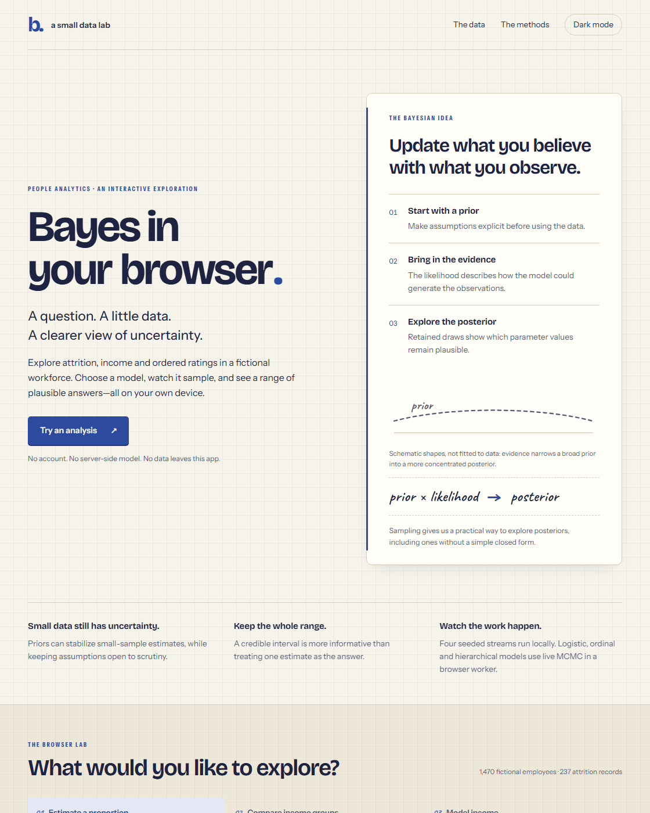

I know I’m a little bit late to the party, but I only recently learned that you can run Bayesian analyses directly in a web browser, including complex regression models whose posteriors we approximate through sampling.

What caught my attention was the possibility of building small, accessible data products with Bayesian analyses, without maintaining an expensive backend to fit the models.

This seems useful for people analytics, where we often work with relatively small datasets. With a suitable model and defensible priors, we can use relevant prior knowledge and express uncertainty in quantities people actually care about. Small samples still leave us with uncertainty, of course, and make our assumptions matter more.

To try this out, I built a [small site](https://lstehlik2809.github.io/bayes-in-your-browser/) inspired by [Andrew Marritt’s free online book, Bayesian Thinking for People Analytics](https://bayesian-thinking.andrewmarritt.ch/), which [I recommended here recently](https://blog-about-people-analytics.netlify.app/posts/2026-09-16-bayesian-thinking-for-people-analytics/).

It uses the familiar [IBM attrition dataset](https://www.kaggle.com/datasets/pavansubhasht/ibm-hr-analytics-attrition-dataset) and lets you estimate attrition proportions, compare income between groups, and fit linear and logistic regressions. It also includes ordinal regression for satisfaction ratings and a hierarchical income model that makes partial pooling across groups visible.

You choose the variables, run the model, and inspect posterior distributions, credible intervals and results tables. You can follow the sampling progress, and diagnostics help you spot when a fit needs more attention.

The calculations run in your browser. The site is plain HTML, CSS and JavaScript hosted on GitHub Pages, with a background worker handling the sampling so the interface stays responsive. There’s no model-fitting server to set up or pay for.

A couple of caveats: the IBM data are fictional, so this is a demonstration, not evidence about an actual workforce. And a friendly interface doesn’t remove the need to think about priors, model fit or what the data can and cannot tell us.

I find this a useful way to make some Bayesian tools available to people who wouldn’t otherwise run R or Python themselves. It also reminded me how much can happen inside a browser these days 🤓

Feel free to [give it a try here](https://lstehlik2809.github.io/bayes-in-your-browser/).

<!-- RELATED:BEGIN -->
## Related notes
- [[bayesian-simulation|Harnessing Bayesian analysis for business process simulation]]
- [[bayesian-thinking-for-people-analytics|Bayesian Thinking for People Analytics]]
- [[job-comparator|A bet on a new job]]
- [[bayesian-networks-in-people-analytics|Use of Bayesian networks in people analytics?]]
- [[decision-tree-foldback|What probability would change your mind about Sam?]]
<!-- RELATED:END -->

---
> 📄 Read the [original post with full outputs](https://blog-about-people-analytics.netlify.app/posts/2026-10-27-bayes-in-your-browser/) on my blog.
