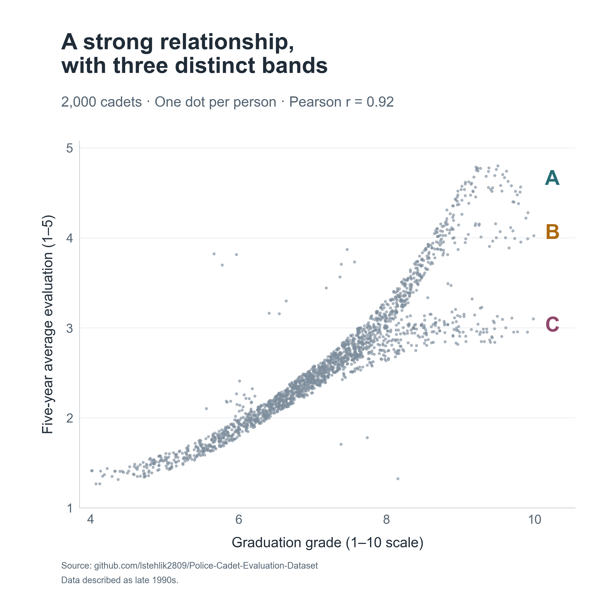

We all know that summary statistics such as correlation can be misleading and that it’s worth examining the data visually.

I recently came across a nice illustration of this in a people analytics context while exploring a [historical dataset of 2,000 police cadets from the Netherlands](https://blog-about-people-analytics.netlify.app/posts/2022-10-24-police-cadet-evaluation-dataset/). The data were used to investigate whether information available at graduation could predict passing the standard five-year evaluation.

Graduation grades and later job ratings correlate at approximately .92 in this dataset. The scatterplot shows a positive but nonlinear relationship. Each dot represents one person, with their average graduation grade and average annual evaluation score over the following five years.

At higher graduation grades, three bands appear:

* A reaches ratings near the top of the 1–5 scale.
* B levels off around 4.
* C levels off around 3.

What caught my attention was the structure of these differences. Some variation in ratings among people with similar grades would be expected. These distinct bands give us something more specific to investigate 🧐

I compared B and C with separate sections of A covering overlapping graduation-grade ranges. The outlines show the approximate selection regions. These are descriptive comparisons; the groups were not individually matched on grades or other characteristics.

Compared with their respective A groups:

* B entered training at around age 29 versus 24; C at around 28 versus 25.
* Both groups had more children at graduation.
* C had a higher proportion of women: approximately 56% versus 4%.

These differences give us questions to investigate. They don’t explain the bands. Age and number of children are closely related here, and graduation grades capture only part of someone’s capabilities for the job.

I would start by checking how the ratings were assigned and aggregated. Could something in the evaluation process or data processing produce these patterns?

If schedules combined with caregiving responsibilities contribute to the gap, we could test different scheduling arrangements. If grades miss relevant competencies, we might reconsider what training develops and assesses. Assignments, support and access to development could also matter.

This dataset cannot distinguish between these explanations. I also identified the bands after inspecting the plot, so we would need to check whether the pattern appears in another cohort.

For me, this is a useful reminder to inspect the shape of a relationship alongside its summary statistics. Structured departures can give us more specific questions to investigate before choosing what to change.

Have you seen similar patterns in your data? Where did the investigation lead, and what did you change?

<!-- RELATED:BEGIN -->
## Related notes
- [[visual-diff-in-diff|Causal insights with no code?]]
- [[causal-inference-in-people-analytics|Beyond prediction: Exploiting organizational events for causal inference in people analytics]]
- [[insights-discovery-and-skills|Do Insights Discovery ‘colors’ relate to self-reported skills?]]
- [[econml-and-employee-attriton|How to get causal interpretation for the Employee Attrition dataset?]]
- [[regression-to-the-mean|Employee commitment over time & regression to the mean]]
<!-- RELATED:END -->

---
> 📄 Read the [original post with full outputs](https://blog-about-people-analytics.netlify.app/posts/2026-10-16-beyond-the-correlation/) on my blog.
