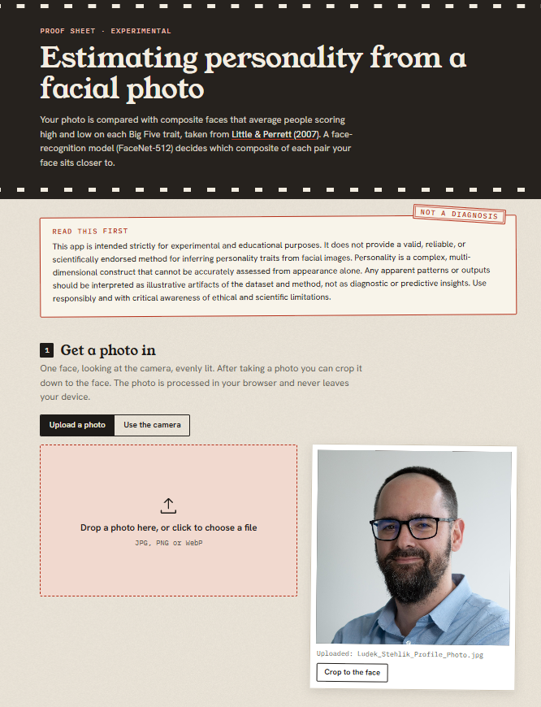
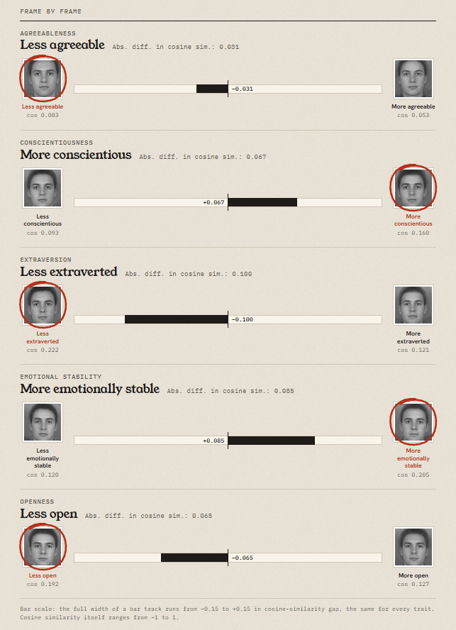

Back in May 2025, I wrote about [a small experiment](https://blog-about-people-analytics.netlify.app/posts/2025-05-20-detecting-personality-in-the-face/): a Python script that compares your facial photo with composite faces of people scoring high and low on the Big Five traits (borrowed from [Little & Perrett, 2007](https://bpspsychub.onlinelibrary.wiley.com/doi/10.1348/000712606X109648)) and then guesses which side of each trait you fall on.

The catch was that trying it meant cloning a repo and installing deepface, which isn't everyone's idea of a fun evening.

I wanted to give Fable 5.2, the new model from Anthropic, a try, and this looked like a nice test case: take my old script and turn it into an app anyone can open. It took two prompts in Claude Code. The first got me [a working app](https://lstehlik2809.github.io/estimating-personality-from-a-facial-photo-app/) hosted on GitHub Pages, and the second added cropping and a nicer design.

What the app does:

* You upload a photo or take one with your webcam, and crop it to your face if needed.
* You pick the male or female set of composites.
* FaceNet-512, the same model the original script used via deepface, turns your face and the composites into embeddings. For each trait, you see which composite of the pair your face is closer to, and by how much.

Everything runs in your browser, so the photo never leaves your device. The only thing that travels is the model itself (about 45 MB, downloaded on the first run).

I compared the app with the original script using the same test photo, and all five verdicts matched, although the specific numbers differed slightly because the app uses a different face detector from the script.

⚠️ Caveats from the original post still apply, and I'm adding a few new ones:

* I'm definitely not claiming this is a valid and reliable way to measure anyone's personality. There may be some signal in faces, but it's so weak and noisy that it's not very practical.
* The composites average just 15 faces each, all from students around 20 years old who, judging by the images, look white (the paper doesn't report ethnicity). The further your face is from that group, the less the comparison means, and it didn't mean much to begin with.
* The app's verdicts rest on small gaps in cosine similarity, and those gaps move when you crop the same photo differently. In my test they shifted by up to about 0.03, which is a lot when the whole gap is 0.05.
* It worked relatively well for me and a few friends with the original script, but I still haven't tested it more widely.
* Try it on your own face, for fun. Please don't use it on candidates, colleagues or anyone else who didn't ask for it.

If you give it a shot, let me know how far off it was 😉

👉 [Link to the app](https://lstehlik2809.github.io/estimating-personality-from-a-facial-photo-app/) and [to the code](https://github.com/lstehlik2809/estimating-personality-from-a-facial-photo-app).

<!-- RELATED:BEGIN -->
## Related notes
- [[detecting-personality-in-the-face|Can a simple algorithm read your personality from your face?]]
- [[openai-personality-interpretation|Ask your personality using GPT]]
- [[ona-and-face-similarity|When facial similarity meets Network Science]]
- [[life-success-personality-profiles|The Big Five and different ways of succeeding]]
- [[dimensional-traits-vs-personality-types|Dimensional Traits vs. Personality Types]]
<!-- RELATED:END -->

---
> 📄 Read the [original post with full outputs](https://blog-about-people-analytics.netlify.app/posts/2026-11-10-detecting-personality-in-the-face-app/) on my blog.
