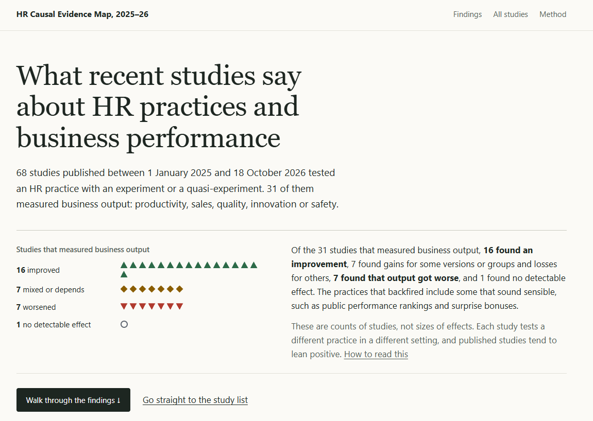

I wanted some inspiration for causal impact evaluations of our internal people projects, so I took a look at recent research on HR practices and business performance.

That turned into the [HR Causal Evidence Map, 2025–26](https://lstehlik2809.github.io/hr-evidence-atlas/). It’s a scoping overview of 68 papers first published online between January 2025 and mid of October 2026, found through a search of 49 selected journals in I/O psychology, organizational research and economics. It includes randomized experiments, quasi-experiments and observational studies using causal inference methods.

31 of the papers measure business output, such as productivity, sales, quality or safety. Of these, 16 report an improvement, 7 report mixed results, 7 report a worse outcome and 1 finds no detectable effect. Public performance rankings and surprise bonuses are among the practices that backfired.

For anyone planning their own evaluation: only 6 of those 31 studies randomized who got the practice. 14 used natural or quasi-experiments, such as policy thresholds or staggered rollouts.

On the site you can scroll through these findings on an evidence map, then filter the studies and read each one’s finding, design and main limitation, with a link to the original paper. The result labels are a first-pass coding drafted with AI, mostly from abstracts, so check the paper before relying on any of them. It’s a one-off scoping review with gaps, not a systematic review.

[Sharing it here](https://lstehlik2809.github.io/hr-evidence-atlas/) in case you find something interesting, or an approach worth trying in a project of your own. 

<!-- RELATED:BEGIN -->
## Related notes
- [[causal-inference-in-people-analytics|Beyond prediction: Exploiting organizational events for causal inference in people analytics]]
- [[evidence-based-hrm-knowledge-test|Evidence-based HRM knowledge test]]
- [[the-triple-filter-test|The Triple-Filter Test: How to prioritize HR interventions with panel data]]
- [[beyond-belief|Evidence-Based Management: Boring basics and better questions]]
- [[encouragement-design-and-ivs|Encouragement Design using instrumental variables]]
<!-- RELATED:END -->

---
> 📄 Read the [original post with full outputs](https://blog-about-people-analytics.netlify.app/posts/2026-10-19-hr-causal-evidence-map/) on my blog.
