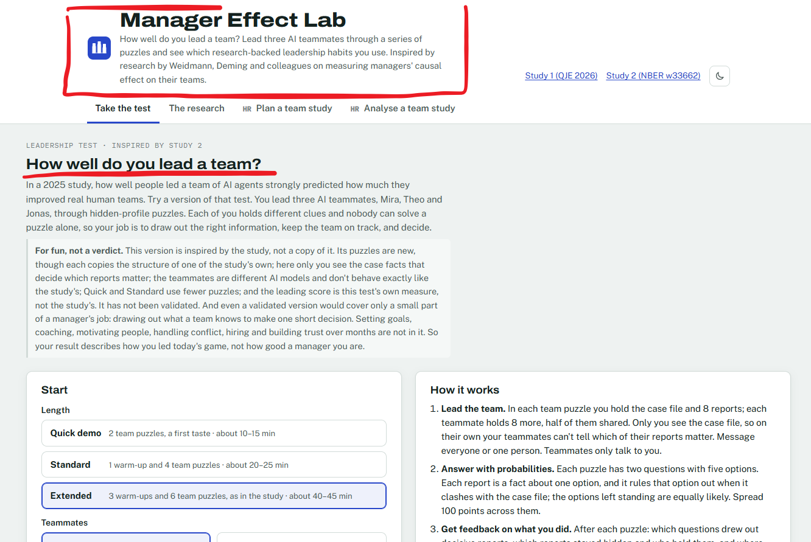
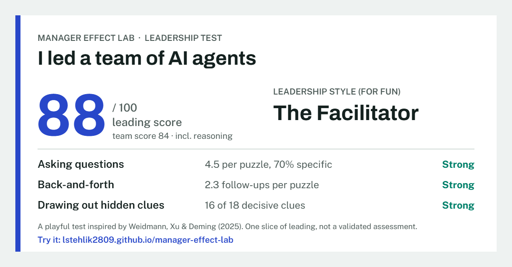

Last year I posted about [two NBER working papers by Weidmann, Deming, and colleagues](https://blog-about-people-analytics.netlify.app/posts/2025-06-12-causal-impact-of-leadership-skills/) that tried to answer a simple-sounding question: how do you tell a good manager from one who just got lucky with their team?

Their answer borrowed from causal inference. Rotate managers at random across several teams, predict each team's result from the individually tested skills of its members, and treat the gap between what the team actually achieved and what was predicted as the manager's contribution. A good manager is one whose teams keep beating the prediction.

The part that stuck with me was the second study. Running this with human teams is a logistical nightmare, so the authors had people lead teams of AI agents instead - and leadership scores with AI teammates correlated 0.81 with scores from human teams. Since every leader gets the same AI teammates, there's no team luck to remove, so the prediction comes from the leader's own solo skills instead.

So I built a playful version you can try yourself 🤓

You lead three AI teammates through "hidden profile" puzzles. Everyone holds some clues, the decisive ones are scattered across the team, and nobody can solve it alone. Your job is to get the right information out of people and put it together. The Quick demo takes 10-15 minutes, no sign-up, no API key - but two puzzles are only a taste, not a measurement. For a fuller reading, try Standard (20-25 minutes) or Extended (about 40 minutes), which runs the study's full set of six team puzzles.

At the end you get feedback based on your own chat - which question drew out which clue, which clues stayed hidden and who was sitting on them - plus a leading score that counts only the points lost in leading the team, not in your own reasoning, rough ratings on the three habits the study linked to effective leaders (asking questions, back-and-forth, drawing out hidden information) and a slightly tongue-in-cheek leadership style. Facilitator? Collector? Or a Broadcaster who keeps asking everyone for everything? 😉

⚠️ A few honest caveats. This is NOT a validated assessment, and it's not a copy of the study either. What it shares with the study: each puzzle copies the structure of one of the study's published puzzles clue for clue, and the team score follows the authors' own scoring code. Where it departs: the puzzles are new, the clues only make sense against a case file that just the leader sees, the AI teammates are a different model and don't behave exactly like the study's, the shorter versions use fewer puzzles, and the leading score is my own addition, not the study's measure. There are no norms either. So the 0.81 belongs to the original study, not to this app.

And even a validated version would cover only a small part of a manager's job: pulling together what a team knows to make one short decision that has a right answer. Setting goals, coaching, motivating people, handling conflict, hiring, building trust over months - none of that is in here. Treat it as a practice mirror for one leadership habit, not a verdict on you as a manager.

On the research side, the first paper has since passed peer review and is out in the Quarterly Journal of Economics (as "How Do You Identify a Good Manager?"), but the AI-agent study, where the 0.81 comes from, is still a working paper under review.

For the people analytics and research crowd, there's also a toolkit behind the test: a calculator showing how many teams each manager needs to lead before an individual estimate means much (spoiler: more than you'd like), a rotation generator, and an analysis tab that implements the full method on your own data.

👉 [Link to the app](https://lstehlik2809.github.io/manager-effect-lab/).

If you give it a go, I'd love to hear whether the feedback felt fair and where the AI teammates behaved weirdly - there are two quick ratings at the end, and you can send them anonymously with one click. Bug reports welcome too. And feel free to drop your result card in the comments - I'll go first 👇

<!-- RELATED:BEGIN -->
## Related notes
- [[causal-impact-of-leadership-skills|Novel way to measure leadership skills via causal inference (and AI)?]]
- [[genai-and-leadership-judgement|Can genAI help people managers lead better?]]
- [[decision-tree-foldback|What probability would change your mind about Sam?]]
- [[ai-assistance-reduces-persistence|What happens to our own performance when the AI is suddenly gone?]]
- [[gpt4-and-e-b-hrm-practices|GPT-4's performance in the knowledge test of evidence-based HRM practices]]
<!-- RELATED:END -->

---
> 📄 Read the [original post with full outputs](https://blog-about-people-analytics.netlify.app/posts/2026-10-26-manager-effect-lab/) on my blog.
