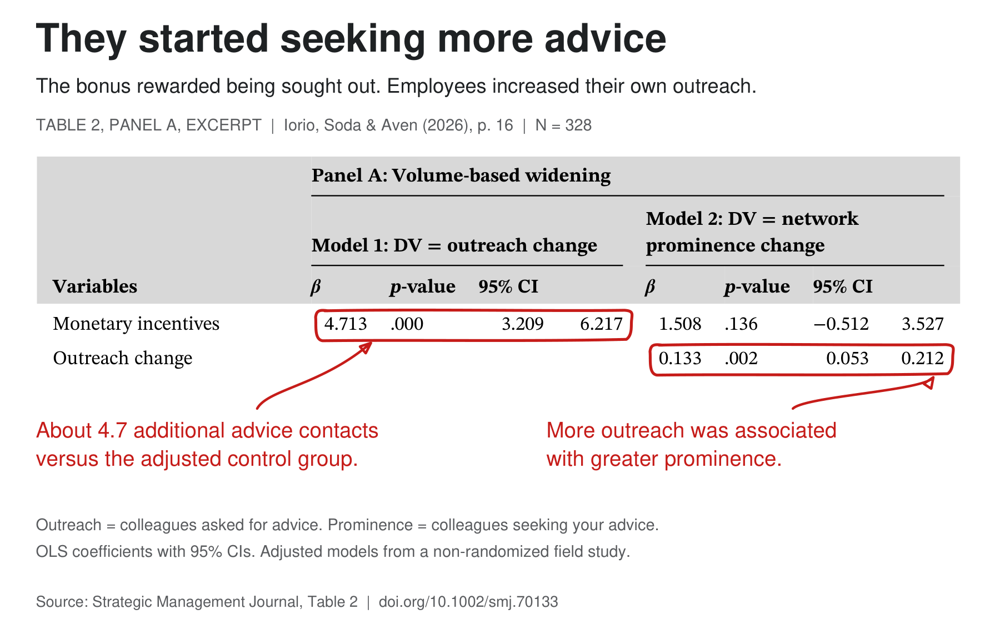
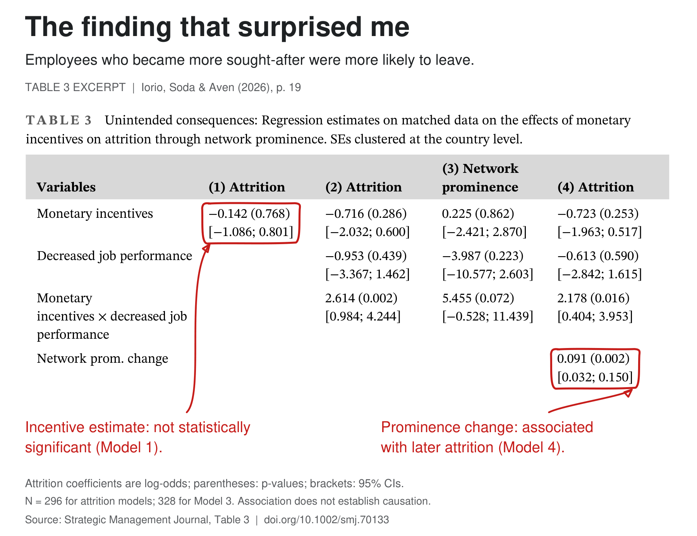

Imagine finding out that part of your annual bonus depends on how many colleagues name you as someone they ask for work-related advice. In organizational network analysis (ONA), that's your in-degree. Your out-degree is how many colleagues you ask for advice.

That's the idea behind pay-for-prominence, which Iorio, Soda & Aven (2026) studied in a [new Strategic Management Journal paper](https://doi.org/10.1002/smj.70133).

They looked at the HR function of a multinational company, where 60 employees were offered a new incentive tied to their position in the informal advice network. The networking goal alone could earn them up to 6% of annual gross salary. The team collected network data before and after the incentive was introduced, with 328 employees taking part in both survey waves.

What caught my attention was how people went about becoming the go-to person.

They asked more people for advice. Their increase in out-degree was about 4.7 advice ties larger than in the adjusted control group (95% CI: 3.2–6.2). They also sought advice more widely across departmental and informal network boundaries. Asking others for advice may be one way to become the go-to person yourself. People who reached out more also tended to gain more prominence, though both changes were measured over the same period.

Then there was a finding I hadn't expected. Among the 296 employees with attrition data, those whose in-degree went up were more likely to leave the company over the next three years.

I'd be careful, though, about jumping from that to “the incentive made people leave.”

People weren't randomly assigned to the incentive, so this was a quasi-experimental field study. The authors used entropy balancing and ran robustness and sensitivity checks, but those can't rule out unobserved confounding.

In the attrition model that left out prominence, the incentive coefficient wasn't statistically significant. An indirect effect is still possible. But the mediation analysis relies on stronger assumptions about what affects both prominence and leaving, and the network changes weren't randomized.

I can see how becoming a go-to person could pile on demands and eventually make someone want to leave. The study doesn't show that's what happened, though. Better outside opportunities could explain it too. Or something the researchers didn't measure, like career ambition, could help explain both the rise in prominence and the decision to leave.

The authors also ran a randomized vignette experiment (N = 354). People assigned to a hypothetical pay-for-prominence scheme listed more people they intended to ask for advice and saw workplace relationships as less communal. That gives us better grounds to say the scheme affected intentions and perceptions. But it doesn't show how people actually behaved or establish the proposed explanation for turnover.

I also kept wondering what the company got out of all this, beyond changes in the network. The authors did look at connectivity and how fragmented the network would become if employees were removed. Their results suggest employees offered the incentive became more important for keeping the network connected, and that removing them would leave bigger gaps. Those results don't tell us whether knowledge quality, productivity, or overall organizational performance improved.

Before tying network metrics to performance management or bonuses, I'd want to be clear about what we're trying to improve. Does the metric actually capture that outcome? I'd also want to see whether the findings hold up outside one company's HR function.

Has anyone here tried ONA-based incentives or used network centrality in performance management? I'd be interested to hear what changed beyond the network itself.

<!-- RELATED:BEGIN -->
## Related notes
- [[instrumental-and-expressive-networks|Not all workplace relationships are created equal when it comes to retaining talent]]
- [[induced-centrality|Induced centralities]]
- [[contagious-turnover|Is contagious turnover overrated? Probably only if you ignore the managers.]]
- [[ai-and-collaboration-networks|What happens to collaboration when AI joins the team?]]
- [[psychometric-network-analysis|Psychometric network analysis & employee survey data]]
<!-- RELATED:END -->

---
> 📄 Read the [original post with full outputs](https://blog-about-people-analytics.netlify.app/posts/2026-11-02-pay-for-prominence/) on my blog.
