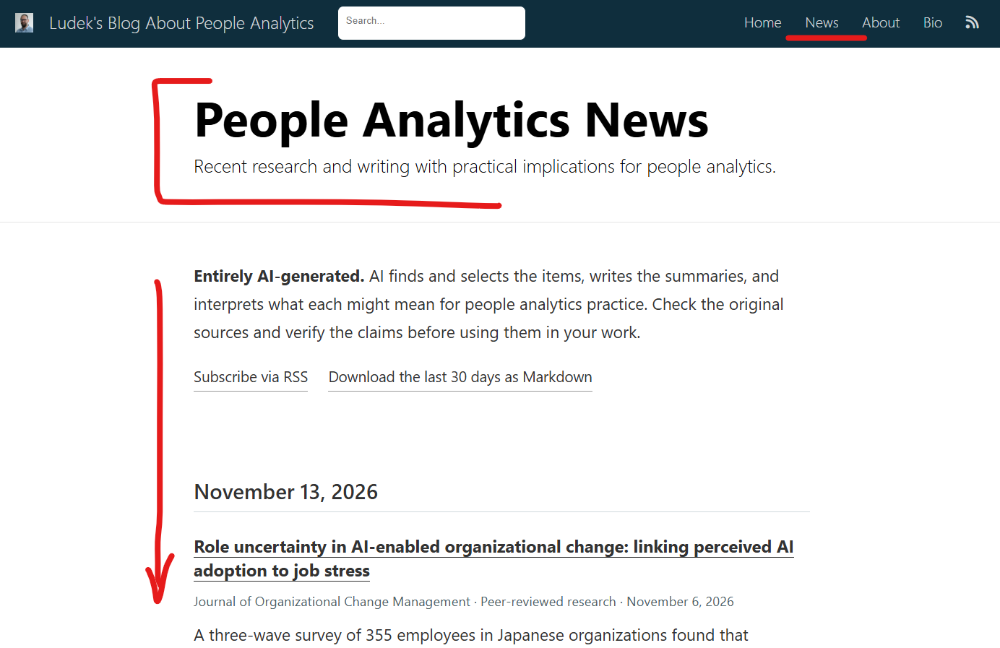

Recently, I’ve been experimenting with a daily AI briefer to help me stay on top of new research that might be relevant for People Analytics practice. I thought some of you might find it useful too, so I added a [News feed](https://blog-about-people-analytics.netlify.app/news) to my blog.

An agent runs daily on GitHub Actions with OpenAI web search. I asked it to find up to five recent pieces worth reading for people analytics, summarize each and suggest where it might be useful in practice. It has a shortlist of journals on work and organizations, personality, psychometrics, cognition and econometrics. It also looks at preprints, company case studies, expert newsletters and LinkedIn, and skips vendor marketing and repeat picks.

⚠️ It’s all AI-generated, from search to presentation, so it can miss good papers, get details wrong or read too much into a finding. I’d check the originals before using any of its takeaways.

If you’re curious, [have a look](https://blog-about-people-analytics.netlify.app/news). You can follow it in your RSS reader or download the last 30 days as Markdown to save or give to your own favorite LLM.

If you fancy making your own, give your reading list and a brief about what’s worth your time to a more approachable tool like Grok Bot or ChatGPT dots.

<!-- RELATED:BEGIN -->
## Related notes
- [[people-analytics-second-brain|My second People Analytics brain - both for people and AI agents]]
- [[hr-tech-ai-shift|How AI is reshaping HR-tech]]
- [[directionally-correct-podcast-topic-explorer|Turning 152 Directionally Correct podcast episodes into an interactive topic explorer]]
- [[agentic-ai-for-visual-data-exploration|Agentic AI for visual data exploration]]
- [[ai-powered-data-exploration-assistant|Testing my GenAI skepticism]]
<!-- RELATED:END -->

---
> 📄 Read the [original post with full outputs](https://blog-about-people-analytics.netlify.app/posts/2026-11-13-people-analytics-news-feed/) on my blog.
