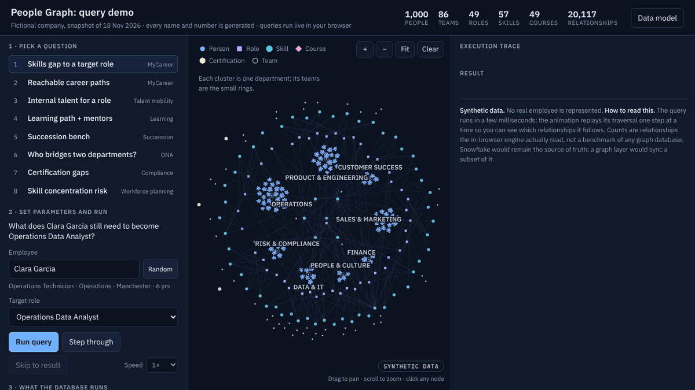

What does querying a people graph actually look like?

People graphs keep popping up in conversations about skills and internal mobility. The idea is to store employees, roles, skills, courses and teams as one connected network, so a question like “which roles could I realistically move to next?” becomes a walk along relationships instead of a stack of SQL joins. I wanted a better feel for how that works, so I let Claude build me a small interactive demo. Maybe you’ll find it useful (and fun) too 🤓

It’s a fictional company with 1,000 employees and about 20,000 relationships between them. You pick one of eight questions, such as a skills gap to a target role, reachable career paths, internal talent for a role, a succession bench or who bridges two departments, and watch the query hop through the graph step by step. Next to it, you see the same query written in Cypher for a graph database and in SQL for a data warehouse. You can also click any person, role or skill to see what it’s connected to.

Playing with it, I noticed that for a lot of typical people analytics questions, a graph doesn’t buy you much over good old SQL. It starts to pay off on paths of unknown length, like career moves, reporting lines or chains of course prerequisites, and on open-ended exploration. That matches what I found last year when I [swapped recursive code for a graph library to compute org stats](https://blog-about-people-analytics.netlify.app/posts/2025-10-31-org-stats-and-graph-analysis/). It’s also the part that could help with [exploring skill adjacency](https://blog-about-people-analytics.netlify.app/posts/2025-06-20-ona-skills-exploration/), which I mused about a while ago.

All the data is made up, and everything runs in your browser. The Cypher and SQL show the logic, but I haven’t run them against a real database.

If you’re thinking about where a graph could fit your own people analytics use cases, maybe it’ll help. Feel free to [give the demo a try](https://lstehlik2809.github.io/people-graph-query-demo/) or [explore the code](https://github.com/lstehlik2809/people-graph-query-demo).

<!-- RELATED:BEGIN -->
## Related notes
- [[org-stats-and-graph-analysis|A graph approach to reporting structures: stop wrestling recursion]]
- [[directionally-correct-podcast-topic-explorer|Turning 152 Directionally Correct podcast episodes into an interactive topic explorer]]
- [[agentic-ai-for-visual-data-exploration|Agentic AI for visual data exploration]]
- [[doppelganger-for-career-pathing|Using Doppelgänger for career pathing?]]
- [[linkedin-contacts-job-positions|Analyzing LinkedIn connections' jobs using LLMs and the BERTopic package]]
<!-- RELATED:END -->

---
> 📄 Read the [original post with full outputs](https://blog-about-people-analytics.netlify.app/posts/2026-11-19-people-graph-query-demo/) on my blog.
