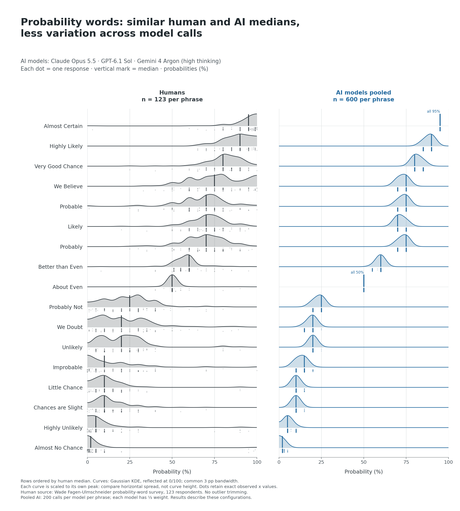
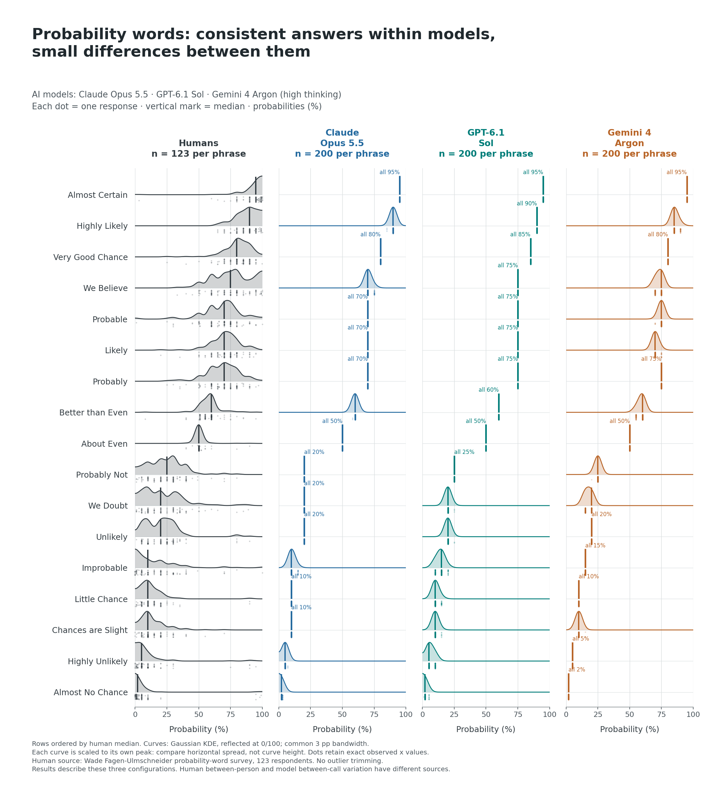

If you've been on LinkedIn lately, you've probably seen posts comparing the "random" numbers humans and AI pick between 1 and 10. The models often kept coming back to 7.

Many of those posts warned about AI making our thinking more homogeneous.

But if you're a fan of [Meehl's work on mechanical prediction](https://en.wikipedia.org/wiki/Paul_E._Meehl#Clinical_versus_statistical_prediction), [Kahneman, Sibony and Sunstein's Noise](https://en.wikipedia.org/wiki/Noise:_A_Flaw_in_Human_Judgment), or [Tetlock and Gardner's Superforecasting](https://en.wikipedia.org/wiki/Philip_E._Tetlock#The_Good_Judgment_Project), you'll know that consistency can be an asset in judgment and forecasting.

That got me wondering how consistently AI maps words like "probably", "little chance" and "we doubt" to numbers.

Back in 2022, I used [Wade Fagen-Ulmschneider's internet survey](https://blog-about-people-analytics.netlify.app/posts/2022-01-18-probability-words/) to look at the numbers 123 people associated with 17 probability phrases. So I decided to try the same questions with LLMs.

I asked Claude Opus 5.5, GPT-6.1 Sol and Gemini 4 Argon, using the original survey's question wording. For each phrase, I collected 200 responses per model, each from a fresh API call with high thinking settings.

The medians were fairly close to the human ones: within 5 percentage points for every phrase and model.

What stood out was how little the models' answers varied. For "unlikely", the middle half of human answers ran from 10% to 30%. For each model, that range narrowed to a single value: 20%. Opus had a zero interquartile range (IQR) for all 17 phrases; Sol and Argon each had zero for 15; among humans, only "about even" had a zero IQR. (Note: A zero IQR doesn't necessarily mean every answer was identical, but just that the lower and upper quartiles coincided, so some answers could still differ - see the chart by model for the full distributions.)

Also worth mentioning, the models didn't always agree with each other, though their medians differed by at most 5 percentage points. For example, for "probably", Opus gave 70% in all 200 calls, while Sol and Argon each gave 75% every time.

That consistency could be useful when translating fuzzy words into numbers, but it doesn't tell us what a particular person meant. Nor does it establish that the models can produce well-calibrated forecasts. That's a separate question, also relevant to the recent discussion of "decision models".

⚠️ Caveat: this compares differences between people in a small convenience sample with repeated calls to each model under one prompt so it may not generalize to more realistic settings.

<!-- RELATED:BEGIN -->
## Related notes
- [[probability-words|How do we perceive probability words?]]
- [[ai-suggestibility|Loftus & Palmer 2.0: Replicating human bias in AI]]
- [[genai-and-leadership-judgement|Can genAI help people managers lead better?]]
- [[ai-powered-data-exploration-assistant|Testing my GenAI skepticism]]
- [[ai-assistance-reduces-persistence|What happens to our own performance when the AI is suddenly gone?]]
<!-- RELATED:END -->

---
> 📄 Read the [original post with full outputs](https://blog-about-people-analytics.netlify.app/posts/2026-11-03-probability-words-humans-vs-ai/) on my blog.
