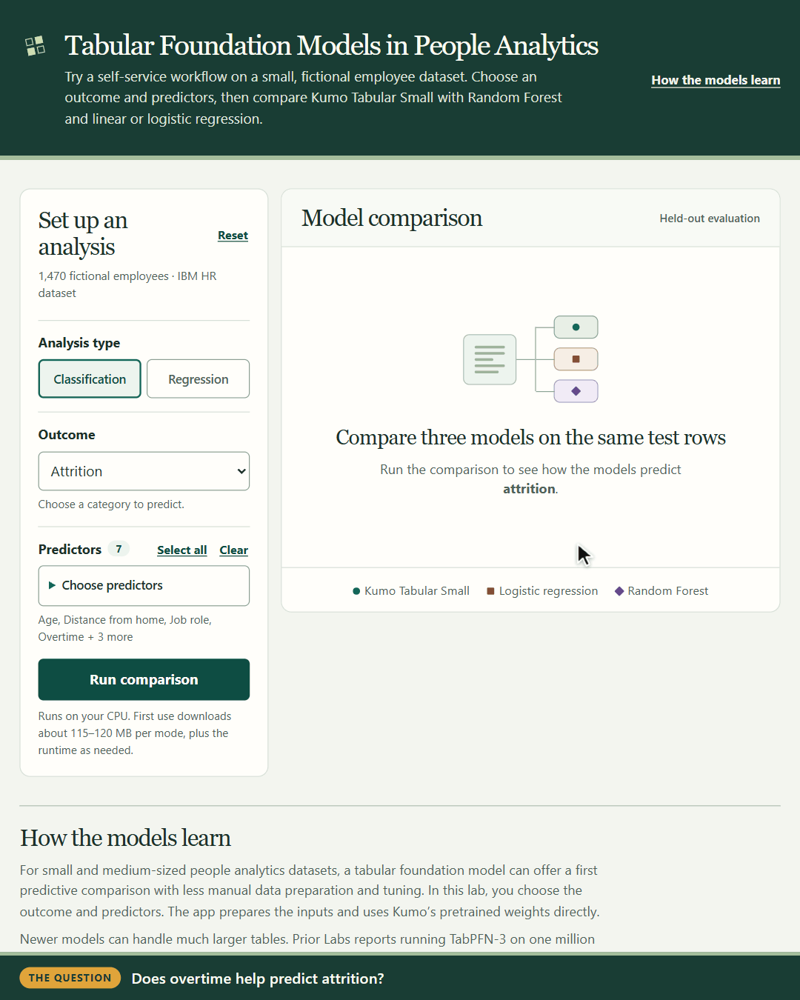

I’ve been seeing papers and posts about tabular foundation models (TFMs) for a while. They sounded interesting, but that was about as far as I got.

I read a bit more about them recently, and it struck me that they might be useful for the sort of data we often work with in People Analytics. I was thinking especially of self-service, where someone might know their HR data well and have little experience with feature engineering or tuning hyperparameters for traditional ML models.

Say you have a reasonably clean table with a few thousand employee records, and you’re curious whether overtime helps predict attrition. You could start with job role, department, and tenure, then add overtime and run the model again. Do the predictions get any better on the same test rows?

Using a TFM is a bit like giving a large language model (LLM) a few examples in a prompt. For a TFM, the examples are rows where you know who stayed and who left. The model uses those examples to predict outcomes for new rows without changing its pretrained weights. That’s called in-context learning.

A TFM is pretrained on lots of prediction tasks, often using synthetic tables. The assumptions behind those tasks form a prior, which can help when you have few labeled examples.

Some TFMs handle categorical columns directly, so you can leave job role and department as they are and start with the default settings. The model can also pick up nonlinear relationships and interactions without you having to specify them up front.

Most of what I’d read was about TabPFN. Its [Nature paper](https://www.nature.com/articles/s41586-024-08328-6) reported better results overall than tuned ML baselines on small and medium-sized tables. That’s the scale I had in mind, though [newer versions](https://priorlabs.ai/technical-reports/tabpfn-3) have been tested on much bigger tables too.

To get a better feel for this, I built a small browser app using the familiar fictional IBM employee dataset. You choose what to predict and which columns to use, then compare a TFM (NVIDIA’s Kumo Tabular Small) with Random Forest and logistic or linear regression on the same test rows.

In the runs I tried, the TFM did about as well as the other models or better, depending on which predictors I used and how I scored the predictions.

If you’re interested, give it a try here 👉 [People Analytics Model Lab](https://lstehlik2809.github.io/people-analytics-model-lab/)

I’m new to TFMs, so I’m curious what others have found. If you’ve tried them in People Analytics, what’s worked for you? What would you suggest I try next?

<!-- RELATED:BEGIN -->
## Related notes
- [[bayes-in-your-browser|Bayes in your browser]]
- [[causal-inference-in-people-analytics|Beyond prediction: Exploiting organizational events for causal inference in people analytics]]
- [[econml-and-employee-attriton|How to get causal interpretation for the Employee Attrition dataset?]]
- [[employee-feedback-analysis-using-openai|Employee feedback analysis using tools from OpenAI]]
- [[multilevel-modeling|Multilevel modeling in people analytics]]
<!-- RELATED:END -->

---
> 📄 Read the [original post with full outputs](https://blog-about-people-analytics.netlify.app/posts/2026-11-24-tabular-foundation-models-in-people-analytics/) on my blog.
